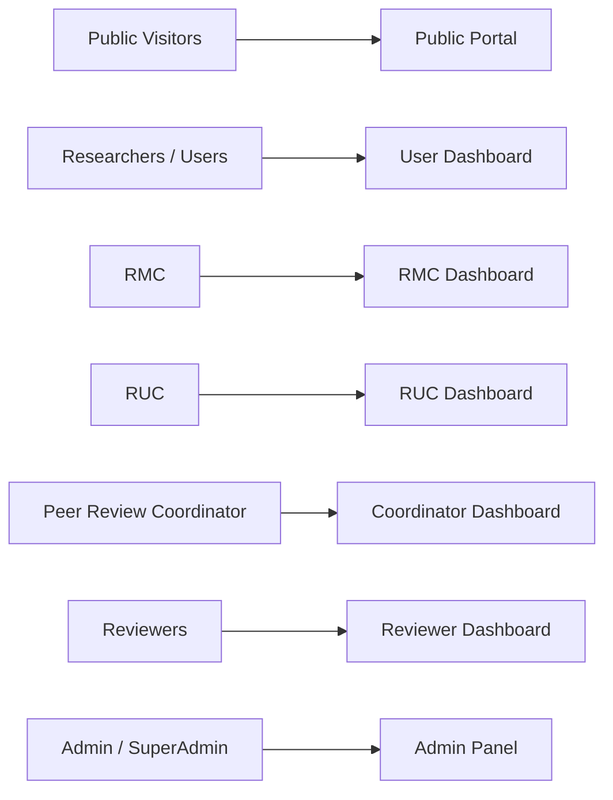
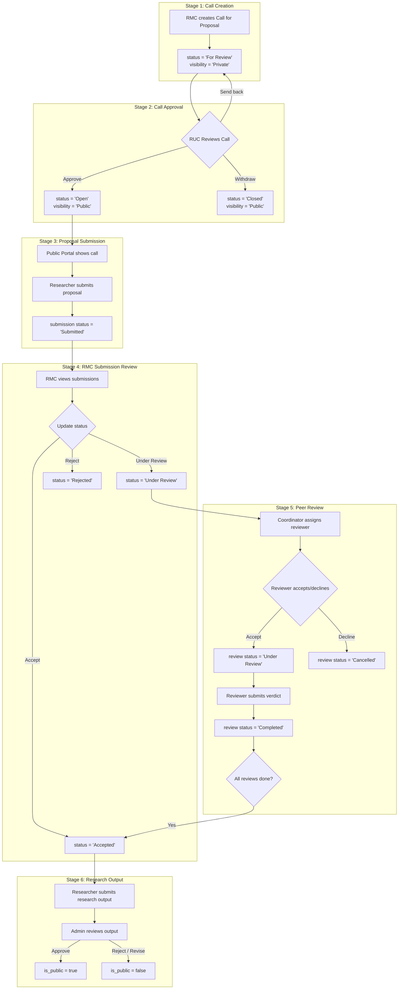
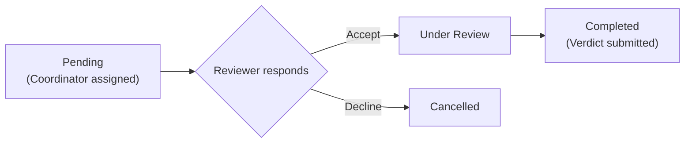
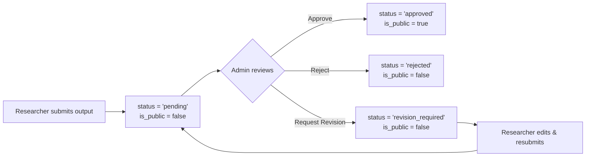
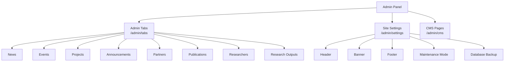

# CVHRDC — System Progress Documentation
**Cagayan Valley Health Research and Development Consortium**
*Generated: June 19, 2026 | Framework: Laravel 10 | Stack: PHP 8.1+, MySQL, Bootstrap 5, Vite*

---

## 1. System Overview

CVHRDC is a **web-based research management and dissemination platform** serving as the centralized digital hub for health research in the Cagayan Valley region of the Philippines. The system supports the full research lifecycle — from public announcement of calls for proposals, to researcher submission, committee review, peer review, and public dissemination of research outputs.



---

## 2. Technology Stack

| Layer | Technology | Notes |
|---|---|---|
| Framework | Laravel 10 | PHP ^8.1 |
| Frontend | Bootstrap 5, Sass/SCSS, Vite | Tailwind config also present |
| Database | MySQL (via XAMPP) | 35 migrations total |
| Authentication | Laravel Breeze + Laravel UI | Email verification supported |
| File Storage | Laravel Storage (local disk) | Linked via `storage:link` |
| Backup | `spatie/laravel-backup` | On-demand & scheduled |
| CAPTCHA | `anhskohbo/no-captcha` | Used in public-facing forms |
| API Client | Guzzle HTTP | Installed |
| API Auth | Laravel Sanctum | Personal access tokens |

---

## 3. User Roles & Access Control

The system uses a **many-to-many role-user** model with role middleware enforced per route group.

| Role | Prefix | Middleware | Status |
|---|---|---|---|
| SuperAdmin | `/superadmin` | `can:superadmin-access` | ⚠️ Scaffolded, not fully built |
| Admin | `/admin` | `auth`, `admin` | ✅ Fully implemented |
| RMC | `/rmc` | `auth`, `rmc` | ✅ Fully implemented |
| RUC | `/ruc` | `auth`, `ruc` | ✅ Fully implemented |
| Peer Review Coordinator | `/coordinator` | `auth`, `coordinator` | ✅ Fully implemented |
| Reviewer | `/reviewer` | `auth`, `reviewer` | ✅ Fully implemented |
| User (Researcher) | `/users` | `can:user-access` | ✅ Fully implemented |

### Role-Based Dashboard Routing
The `/dashboard` route intelligently redirects each user to their role-specific dashboard using a switch dispatch in `web.php`.

---

## 4. Integrated Feature Modules

### 4.1 🌐 Public Portal (`/`)

- **Landing page** (`welcome.blade.php` — 41KB) with full public-facing content
- **News listings** — publicly visible articles
- **Events calendar** — upcoming events
- **Projects showcase** — active research projects
- **Publications** — publicly released research outputs
- **Announcements** — institutional notices
- **Partner organizations** — partner logos and links
- **Calls for Proposals** (`/calls`, `/calls/{id}`) — lists open, public calls
- **Format file download** — researchers can download the proposal template
- **Public API endpoint** — `/api/public-calls` feeds call data via JSON

**Models involved:** `News`, `Event`, `Project`, `Publication`, `Announcement`, `Partner`, `CallForProposal`, `Banner`, `Header`, `Footer`

---

### 4.2 🔐 Authentication & Profile

- **Registration & Login** via Laravel Breeze + `auth.php` routes
- **Email verification** supported (`email_verified_at` field)
- **Password reset** flow (standard Breeze)
- **Profile management** — edit name, email, address, campus; change password; delete account
- **CAPTCHA** integration on public forms

---

### 4.3 🗃️ Research Output Repository (User-Submitted)

> For full details on the research output models, controllers, user dashboard endpoints, and the planned approval workflow, see **§4.4.6 Stage 6 — Research Output Submission & Approval** below.

---

### 4.4 📢 End-to-End Proposal Pipeline

The CVHRDC platform implements a **six-stage research lifecycle pipeline** that governs how research proposals flow from institutional call creation through peer review and ultimately to published research outputs. Each stage involves different user roles, controllers, and status transitions.



---

#### 4.4.1 Stage 1 — Call for Proposal Creation (RMC)

The Research Management Committee (RMC) initiates the pipeline by creating calls for proposals.

**Controller:** `App\Http\Controllers\RMC\CallForProposalController`
**Route prefix:** `/rmc` — Middleware: `['auth', 'rmc']`

##### Routes

| Method | URI | Controller Method | Route Name |
|---|---|---|---|
| GET | `/rmc/calls` | `index` | `rmc.calls.index` |
| GET | `/rmc/calls/create` | `create` | `rmc.calls.create` |
| POST | `/rmc/calls` | `store` | `rmc.calls.store` |
| GET | `/rmc/calls/{id}` | `show` | `rmc.calls.show` |
| GET | `/rmc/calls/{id}/edit` | `edit` | `rmc.calls.edit` |
| PUT | `/rmc/calls/{id}` | `update` | `rmc.calls.update` |
| DELETE | `/rmc/calls/{id}` | `destroy` | `rmc.calls.destroy` |
| POST | `/rmc/calls/{id}/visibility` | `updateVisibility` | `rmc.calls.visibility` |
| GET | `/rmc/calls/{id}/download-format` | `downloadFormatFile` | `rmc.calls.download-format` |

##### Model: `CallForProposal`

**Table:** `call_for_proposals`

**Fillable fields:** `title`, `description`, `research_priority_area`, `eligibility`, `guidelines`, `funding_limit`, `proposal_format_file`, `start_date`, `end_date`, `status`, `visibility_status`, `created_by`, `approved_by`

**Casts:** `start_date` → date, `end_date` → date, `funding_limit` → decimal:2

**Relationships:**
- `creator()` → `belongsTo(User::class, 'created_by')`
- `approver()` → `belongsTo(User::class, 'approved_by')`
- `proposalSubmissions()` → `hasMany(ProposalSubmission::class, 'call_id')`

##### Status & Visibility Lifecycle

| Status Value | Visibility | Meaning |
|---|---|---|
| `Draft` | `Private` | Initial state, not yet submitted for review |
| `For Review` | `Private` | Submitted to RUC for approval (default on create) |
| `Open` | `Public` | Approved by RUC and visible on public portal |
| `Closed` | `Public` | Deadline passed or manually closed |

**On creation:** `status` defaults to `For Review`, `visibility_status` defaults to `Private`, `created_by` auto-set to authenticated user ID.

##### Store Validation Rules

```
title                  → required|string|max:255
description            → required|string
research_priority_area → required|string|max:255
eligibility            → required|string
guidelines             → required|string
funding_limit          → required|numeric|min:0
proposal_format_file   → nullable|file|mimes:pdf,doc,docx|max:10240
start_date             → required|date
end_date               → required|date|after:start_date
status                 → nullable|in:Draft,For Review,Open,Closed
visibility_status      → nullable|in:Private,Public
```

##### Authorization Logic
- **Edit guard:** Only the creator (`created_by === Auth::id()`) can edit. Publicly posted calls (`visibility_status === 'Public'`) are **locked from editing**.
- **Delete guard:** Same creator-only rule. Public calls cannot be deleted — RUC must withdraw first.
- **Visibility toggle:** Creator-only, JSON API response.

##### Filtering & Sorting
- **Tab filter:** `all-calls` (default), `my-calls` (filtered by `created_by`)
- **Search:** title, research_priority_area, description
- **Status filter:** exact match on status
- **Visibility filter:** Private/Public
- **Date filter:** last 7/30/180 days, or custom range (on `start_date`/`end_date`)
- **Sort:** newest (default), oldest, A→Z, Z→A, funding high→low, funding low→high
- **AJAX support:** Full JSON response with rendered HTML partial

##### File Handling
- Format file stored via `Storage::disk('public')` at path `proposal_formats/{timestamp}_{filename}`
- On update, old file is deleted before new upload
- On delete, associated file is also removed

---

#### 4.4.2 Stage 2 — Call Approval (RUC)

The Research Utilization Committee (RUC) reviews, approves, or sends back calls created by the RMC.

**Controller:** `App\Http\Controllers\RUC\CallForProposalController`
**Route prefix:** `/ruc` — Middleware: `['auth', 'ruc']`

##### Routes

| Method | URI | Controller Method | Route Name |
|---|---|---|---|
| GET | `/ruc/calls` | `index` | `ruc.calls.index` |
| GET | `/ruc/calls/{id}` | `show` | `ruc.calls.show` |
| POST | `/ruc/calls/{id}/status` | `updateStatus` | `ruc.calls.status` |
| GET | `/ruc/calls/{id}/download-format` | `downloadFormatFile` | `ruc.calls.download-format` |
| GET | `/ruc/review-calls` | `getForReview` | `ruc.calls.review` |
| GET | `/ruc/published-calls` | `getPublished` | `ruc.calls.published` |

##### Workflow Actions (`updateStatus`)

The RUC can perform four workflow actions via the `updateStatus` method:

| Action | Input Status | Result Status | Result Visibility | Effect |
|---|---|---|---|---|
| `approve` | `Open` | `Open` | `Public` | Call is published to public portal; `approved_by` set |
| `withdraw` | `Closed` | `Closed` | `Public` | Call is closed; stays visible as closed |
| `reopen` | `For Review` | `For Review` | `Private` | Call sent back to RMC for revision |
| *(standard)* | any valid | as provided | unchanged | Generic status update |

**Validation:** `status` must be in `Draft, For Review, Open, Closed`; `action` must be in `approve, withdraw, close, reopen`

##### Tab Filtering
- **`for-review` tab:** Shows calls with status `For Review` or `Draft`
- **`published` tab:** Shows calls with `visibility_status = 'Public'`
- **`all-calls` tab (default):** Shows all calls

##### Filtering & Sorting
Same comprehensive filtering as RMC: search (title, priority area, description), status, visibility, date range, and sorting (newest, oldest, A→Z, Z→A, funding high/low). Full AJAX support.

---

#### 4.4.3 Stage 3 — Public Call Display & Proposal Submission

Once a call is approved and published, it appears on the public portal. Researchers can then submit proposals through the user dashboard.

##### Public Portal

**Controller:** `App\Http\Controllers\Public\CallController`
**Routes:** `GET /calls` (index), `GET /calls/{id}` (show), `GET /calls/{id}/download-format`

**Key behavior:**
- Only shows calls where `visibility_status = 'Public'`
- Calls `updateStatusBasedOnDates()` on every access — auto-closes calls past `end_date`
- Display status computed from model accessor `getDisplayStatusAttribute()`:
  - Before `start_date` → `Upcoming`
  - Between `start_date` and `end_date` with status `Open` → `Open`
  - Past `end_date` → `Closed`
- `isAcceptingSubmissions()` returns true only when `display_status === 'Open'` AND `visibility_status === 'Public'`
- AJAX JSON feed via `getPublicCalls()` for landing page widget (returns latest 6 calls)
- Sort options include `deadline_soon` (order by end_date ascending)

##### Researcher Proposal Submission

**Controller:** `App\Http\Controllers\Users\UserProposalSubmissionController`
**Route prefix:** `/users` — Middleware: `can:user-access`

##### Routes

| Method | URI | Controller Method | Route Name |
|---|---|---|---|
| GET | `/users/proposal-submissions` | `index` | `users.proposal-submissions.index` |
| GET | `/users/proposal-submissions/create` | `create` | `users.proposal-submissions.create` |
| POST | `/users/proposal-submissions` | `store` | `users.proposal-submissions.store` |
| GET | `/users/proposal-submissions/{id}` | `show` | `users.proposal-submissions.show` |
| GET | `/users/proposal-submissions/{id}/download` | `download` | `users.proposal-submissions.download` |

##### Model: `ProposalSubmission`

**Table:** `proposal_submissions`

**Fillable fields:** `call_id`, `user_id`, `research_title`, `proponent_name`, `affiliation`, `email`, `contact_number`, `proposal_document`, `budget_requested`, `date_submitted`, `status`, `remarks`

**Casts:** `budget_requested` → decimal:2, `date_submitted` → datetime

**Relationships:**
- `user()` → `belongsTo(User::class)`
- `callForProposal()` → `belongsTo(CallForProposal::class, 'call_id')`
- `peerReviews()` → `hasMany(PeerReview::class, 'proposal_submission_id')`

##### Store Validation Rules

```
call_id           → required|exists:call_for_proposals,id
research_title    → required|string|max:255
proponent_name    → required|string|max:255
affiliation       → required|string|max:255
email             → required|email|max:100
contact_number    → required|string|max:20|regex:/^[0-9+\-\(\)\s]+$/
proposal_document → required|file|mimes:pdf,doc,docx|max:10240
budget_requested  → required|numeric|min:0|max:999999999.99
```

**On submission:**
- System verifies `call.isAcceptingSubmissions()` before allowing submission
- `status` automatically set to `Submitted`
- `date_submitted` set to `now()`
- `user_id` set to authenticated user
- Document stored at `proposal_submissions/{timestamp}_{sanitized_filename}` on public disk

##### Authorization
- **Index:** Only shows the authenticated user's own submissions (`user_id = Auth::id()`)
- **Show:** Ownership check enforced — `403` if not owner
- **Download:** Ownership check enforced; original filename restored (timestamp prefix stripped)

##### Filtering & Sorting
- **Search:** research_title, proponent_name, affiliation, call title (via `whereHas`)
- **Status filter:** exact match
- **Date filter:** last 7/30/180 days, custom range (on `date_submitted`)
- **Sort:** newest (default), oldest, A→Z, Z→A, budget high→low, budget low→high
- **AJAX support:** Full JSON response

##### Submission Status Lifecycle

| Status Value | Who Sets It | Meaning |
|---|---|---|
| `Submitted` | System (auto) | Initial state when researcher submits |
| `Under Review` | System (auto) | Set when a reviewer accepts a peer review assignment |
| `Accepted` | RMC or System | Manually set by RMC, or auto-set when all peer reviews complete |
| `Rejected` | RMC | Proposal rejected by RMC |

---

#### 4.4.4 Stage 4 — RMC Submission Review

The RMC reviews proposals submitted against their calls.

**Controller:** `App\Http\Controllers\RMC\ProposalSubmissionController`
**Route prefix:** `/rmc` — Middleware: `['auth', 'rmc']`

##### Routes

| Method | URI | Controller Method | Route Name |
|---|---|---|---|
| GET | `/rmc/submissions` | `index` | `rmc.submissions.index` |
| GET | `/rmc/calls/{callId}/submissions` | `showCallSubmissions` | `rmc.submissions.call` |
| GET | `/rmc/calls/{callId}/submissions/{id}` | `show` | `rmc.submissions.show` |
| POST | `/rmc/calls/{callId}/submissions/{id}/status` | `updateStatus` | `rmc.submissions.status` |
| GET | `/rmc/calls/{callId}/submissions/{id}/download` | `downloadDocument` | `rmc.submissions.download` |

##### Key Behavior
- **Index:** Shows all submissions across calls created by the authenticated user (`created_by = Auth::id()`)
- **Call filter:** `showCallSubmissions` narrows to a specific call — with creator ownership check
- **Authorization:** All actions enforce that the call was created by the authenticated user (403 if not)
- **Status update:** JSON API — validates `status` in `Submitted, Under Review, Accepted, Rejected` and optional `remarks`
- **Document download:** Creator-only access via `Storage::disk('public')`

---

#### 4.4.5 Stage 5 — Peer Review Pipeline

The peer review system enables expert evaluation of submitted proposals. It involves two roles: **Coordinator** (assigns reviewers) and **Reviewer** (evaluates proposals).

##### Coordinator

**Controller:** `App\Http\Controllers\Coordinator\PeerReviewCoordinatorController`
**Route prefix:** `/coordinator` — Middleware: `['auth', 'coordinator']`

###### Routes

| Method | URI | Controller Method | Route Name |
|---|---|---|---|
| GET | `/coordinator/dashboard` | `index` | `coordinator.dashboard` |
| GET | `/coordinator/submissions` | `submissions` | `coordinator.submissions.index` |
| GET | `/coordinator/submissions/{id}` | `show` | `coordinator.submissions.show` |
| GET | `/coordinator/submissions/{id}/download` | `download` | `coordinator.submissions.download` |
| POST | `/coordinator/submissions/assign` | `assignReviewer` | `coordinator.submissions.assign` |
| DELETE | `/coordinator/submissions/{submissionId}/unassign/{reviewId}` | `unassignReviewer` | `coordinator.submissions.unassign` |

###### Dashboard Statistics
```php
'total_submissions'    → ProposalSubmission::count()
'pending_assignments'  → ProposalSubmission::whereDoesntHave('peerReviews')->count()
'active_reviews'       → PeerReview::where('status', 'Under Review')->count()
'completed_reviews'    → PeerReview::where('status', 'Completed')->count()
```

###### Assign Reviewer Logic
- **Validation:** `submission_id` must exist; `reviewer_ids` is an array of valid user IDs
- **Guard:** Only allows assignment when submission status is `Submitted` (not `Accepted` or others)
- **Duplicate check:** Skips reviewers already assigned to the same submission
- **Transaction:** Uses `DB::beginTransaction()` for atomicity
- **PeerReview creation:** For each new reviewer: `status = 'Pending'`, `assigned_by = Auth::id()`
- **Reviewer pool:** Fetched by looking up the `Reviewer` role and returning its associated users

###### Unassign Reviewer Logic
- Deletes the `PeerReview` record
- If no remaining reviewers and submission was `Under Review`, reverts submission status to `Submitted`

###### Filtering & Sorting
- **Search:** research_title, proponent_name, affiliation, call title
- **Status filter:** exact match on submission status
- **Date filter:** last 7/30/180 days, custom range (on `date_submitted`)
- **Sort:** newest (default), oldest, A→Z, Z→A
- **AJAX support:** Full JSON response

---

##### Reviewer

**Controller:** `App\Http\Controllers\Reviewer\PeerReviewController`
**Route prefix:** `/reviewer` — Middleware: `['auth', 'reviewer']`

###### Routes

| Method | URI | Controller Method | Route Name |
|---|---|---|---|
| GET | `/reviewer/dashboard` | `dashboard` | `reviewer.dashboard` |
| GET | `/reviewer/reviews` | `index` | `reviewer.reviews.index` |
| GET | `/reviewer/reviews/{id}` | `show` | `reviewer.reviews.show` |
| POST | `/reviewer/reviews/{id}/accept` | `accept` | `reviewer.reviews.accept` |
| POST | `/reviewer/reviews/{id}/decline` | `decline` | `reviewer.reviews.decline` |
| POST | `/reviewer/reviews/{id}/verdict` | `submitVerdict` | `reviewer.reviews.verdict` |
| GET | `/reviewer/reviews/{id}/download` | `downloadDocument` | `reviewer.reviews.download` |

###### Model: `PeerReview`

**Table:** `peer_reviews` — Uses `SoftDeletes`

**Fillable fields:** `proposal_submission_id`, `reviewer_id`, `assigned_by`, `status`, `recommendation`, `comments`, `review_file`

**Relationships:**
- `submission()` → `belongsTo(ProposalSubmission::class, 'proposal_submission_id')`
- `reviewer()` → `belongsTo(User::class, 'reviewer_id')`
- `coordinator()` → `belongsTo(User::class, 'assigned_by')`

###### Peer Review Status Lifecycle



| Status | Who Sets It | Meaning |
|---|---|---|
| `Pending` | System (on assign) | Reviewer has been assigned but hasn't responded |
| `Under Review` | Reviewer (accept) | Reviewer accepted; actively reviewing |
| `Completed` | Reviewer (verdict) | Reviewer submitted recommendation and comments |
| `Cancelled` | Reviewer (decline) | Reviewer declined the invitation |

###### Accept Logic
- Sets review `status` to `Under Review`
- **Side effect:** If submission status is `Submitted`, auto-updates it to `Under Review`
- Uses `DB::beginTransaction()` for atomicity

###### Decline Logic
- Sets review `status` to `Cancelled`

###### Verdict Submission

**Validation:**
```
recommendation → required|in:Accept Submission,Revisions Required (Minor),Resubmit for Review,Resubmit Elsewhere,Decline Submission
comments       → required|string|min:20|max:5000
```

**Behavior:**
- Sets `recommendation`, `comments`, and `status = 'Completed'` on the PeerReview record
- **Auto-completion check:** After verdict, checks if ALL remaining reviews for the same submission are either `Completed` or `Cancelled`. If so, auto-sets submission `status = 'Accepted'`
- Uses `DB::beginTransaction()` for atomicity

###### Double-Blind Support
- **Show guard:** Reviewer can only view submissions they've accepted (`status` in `Under Review` or `Completed`)
- **Document download:** Files are renamed to `submission_{review_id}_{date}.pdf` to strip author-identifying filenames

###### Dashboard Statistics
```php
'total'        → count of all reviews for this reviewer
'pending'      → status = 'Pending'
'under_review' → status = 'Under Review'
'completed'    → status = 'Completed'
'cancelled'    → status = 'Cancelled'
```

###### Tab-Based Filtering
- **`invitations` tab (default):** Shows `Pending` reviews
- **`assignments` tab:** Shows `Under Review`, `Completed`, and `Cancelled` reviews
- **Search:** research_title, proponent_name (via `whereHas`)
- **Status filter:** exact match (assignments tab only)
- **Date filter:** last 7/30/180 days, custom range (on `created_at`)
- **Sort:** newest, oldest, A→Z (join on proposal_submissions), Z→A
- **AJAX support:** Full JSON response

---

#### 4.4.6 Stage 6 — Research Output Submission & Approval

After a proposal is accepted, researchers can submit their completed research as outputs. This is the final stage of the pipeline.

##### Current Implementation (Research Output Repository)

Researchers submit research outputs through four controllers:

| Output Type | Controller | Route Prefix |
|---|---|---|
| Research Papers | `UserResearchCTRL` | `/users/research` |
| Preprints | `UserPreprintController` | `/users/preprints` |
| Conference Papers | `UserConferencePaperController` | `/users/conference-papers` |
| Books | `UserBookController` | `/users/books` |

**Features per output type (current):**
- ✅ Full CRUD (Create, Read, Update, Delete)
- ✅ Soft delete with restore capability
- ✅ Force (permanent) delete
- ✅ Visibility toggle (`is_public` boolean)
- ✅ File upload with owner-only secure download
- ✅ Comprehensive search, filter, sort with AJAX support
- ✅ JSON data feed endpoints for user dashboard

**Admin overlay:** Admins have parallel CRUD + visibility + restore/force-delete control via the `/admin` panel through `ResearchController`, `ConferencePaperController`, `PreprintController`, and `BookController`.

##### Planned: Research Output Approval Workflow

> See [RESEARCH_OUTPUT_WORKFLOW_IMPLEMENTATION_PLAN.md](file:///c:/xampp/htdocs/CVHRDC/RESEARCH_OUTPUT_WORKFLOW_IMPLEMENTATION_PLAN.md) for the full implementation plan.

The planned workflow introduces a formal `Pending → Admin Review → Approved / Rejected / Revision Required` status lifecycle to all four output types:



**Key changes (planned, not yet implemented):**
- New `status` column (`pending`, `approved`, `rejected`, `revision_required`) on all 4 output tables
- New `admin_remarks` column for reviewer feedback
- `is_public` auto-driven by `status` (no more manual toggle by researchers)
- Admin review queue with pending count badges
- Researcher sees admin remarks and can resubmit when status is `revision_required`

> **⚠️ Status:** This workflow is **planned but not yet implemented**. Currently, researchers can self-publish outputs by toggling `is_public` directly.

---

#### 4.4.7 Pipeline Summary — Status Flow Reference

The following table traces a research proposal through every status transition in the system:

| Stage | Entity | Status Field | Status Values | Transitions |
|---|---|---|---|---|
| **1. Call Creation** | `CallForProposal` | `status` + `visibility_status` | Draft, For Review, Open, Closed × Private, Public | RMC creates → `For Review / Private` |
| **2. Call Approval** | `CallForProposal` | `status` + `visibility_status` | (same) | RUC approves → `Open / Public`; RUC reopens → `For Review / Private` |
| **3. Proposal Submission** | `ProposalSubmission` | `status` | Submitted, Under Review, Accepted, Rejected | System auto-sets `Submitted` on create |
| **4. RMC Review** | `ProposalSubmission` | `status` | (same) | RMC manually sets Under Review / Accepted / Rejected with optional remarks |
| **5a. Peer Assignment** | `PeerReview` | `status` | Pending, Under Review, Completed, Cancelled | Coordinator assigns → `Pending` |
| **5b. Peer Verdict** | `PeerReview` | `status` + `recommendation` | (status as above) + 5 recommendation values | Reviewer accepts → `Under Review`; submits verdict → `Completed` |
| **5c. Auto-Completion** | `ProposalSubmission` | `status` | (inherits) | When all reviews done → submission auto-set to `Accepted` |
| **6. Research Output** | `Research` / etc. | `is_public` (current) or `status` (planned) | true/false (current) or pending/approved/rejected/revision_required (planned) | Current: self-publish toggle. Planned: admin approval required |

#### 4.4.8 Pipeline — Role Responsibility Matrix

| Capability | RMC | RUC | Coordinator | Reviewer | Researcher | Admin |
|---|---|---|---|---|---|---|
| Create calls for proposals | ✅ | ❌ | ❌ | ❌ | ❌ | ❌ |
| Approve/reject calls | ❌ | ✅ | ❌ | ❌ | ❌ | ❌ |
| View public calls | ❌ | ❌ | ❌ | ❌ | ✅ | ✅ |
| Submit proposals | ❌ | ❌ | ❌ | ❌ | ✅ | ❌ |
| Review submissions (status) | ✅ | ❌ | ❌ | ❌ | ❌ | ❌ |
| Download submitted documents | ✅ | ❌ | ✅ | ✅* | ✅† | ❌ |
| Assign reviewers | ❌ | ❌ | ✅ | ❌ | ❌ | ❌ |
| Accept/decline review | ❌ | ❌ | ❌ | ✅ | ❌ | ❌ |
| Submit review verdict | ❌ | ❌ | ❌ | ✅ | ❌ | ❌ |
| Submit research outputs | ❌ | ❌ | ❌ | ❌ | ✅ | ❌ |
| Approve research outputs | ❌ | ❌ | ❌ | ❌ | ❌ | ✅‡ |

*\* Double-blind: filename anonymized*
*† Own submissions only*
*‡ Planned — not yet implemented*

---

---

### 4.5 🛠️ Admin Content Management

> For full details including model fields, validation rules, filtering dimensions, and AJAX support for each module, see **§4.6 Content Management System (CMS) — Detailed Architecture** below.
>
> For research output management (Research Papers, Preprints, Conference Papers, Books), see **§4.4.6 Stage 6 — Research Output Submission & Approval** above.

---

### 4.6 ⚙️ Content Management System (CMS) — Detailed Architecture

The CMS is the backbone of the CVHRDC public portal, allowing administrators to create, edit, publish, and control the visibility of all institutional content without touching code. It is composed of three subsystems:

1. **Admin Tabs** — a tabbed interface for managing content modules (News, Events, Projects, etc.)
2. **Site Settings** — a separate tabbed panel for configuring Header, Banner, Footer, and Maintenance
3. **CMS Controller** — a scaffolded resource controller for future generic page management



---

#### 4.7.1 Admin Tabs System (`AdminTabsController`)

The Admin Tabs system is the **central hub** for all content management. It is served by `AdminTabsController` at the route `GET /admin/tabs/{tab?}` (named `admin.tabs.index`).

**How it works:**
- The controller accepts a `tab` parameter (defaults to `news`) and validates it against the allowed set: `news`, `research`, `projects`, `events`, `publications`, `researchers`, `partners`, `announcements`.
- For each tab, it loads the corresponding model data with full **search, filter, sort, and pagination** logic applied directly inside the controller.
- The view `admin.tabs.index` renders a tabbed interface; each tab's content is loaded from a Blade partial in `resources/views/admin/tabs/partials/`.
- Each content module also has a **dedicated resource controller** (e.g., `NewsController`, `EventController`) that handles CRUD operations. These controllers redirect back to `admin.tabs.index` for regular page requests, and return **JSON responses** for AJAX requests (real-time search).

**AJAX Support:**
All major content modules (News, Events, Projects, Partners, Announcements) support AJAX-based real-time search and filtering. When the request header indicates `expectsJson()` or `ajax()`, the controller returns a JSON response containing:
- `html` — server-rendered HTML of the card partial
- `pagination` — rendered pagination links
- `totalCount`, `currentCount`, `from`, `to` — result metadata

**Paginated results:** All listings use Laravel's `paginate(8)` with `appends()` to preserve query parameters across pages.

---

#### 4.7.2 Content Module Details

Each content module follows a consistent pattern: a **Model** with fillable fields and casts, a **Resource Controller** with CRUD + visibility toggling, and a **Blade partial** for rendering. All content routes are under the `/admin` prefix with `['auth', 'admin']` middleware.

---

##### 📰 News

| Aspect | Detail |
|---|---|
| **Model** | `App\Models\News` |
| **Controller** | `Admin\NewsController` |
| **Routes** | `Route::resource('news', NewsController::class)` + `POST news/{id}/visibility` |
| **View Partials** | `admin/tabs/partials/news.blade.php`, `news-cards.blade.php` |

**Model fields (`$fillable`):** `title`, `content`, `image`, `published_at`, `is_visible`, `added_by`

**Casts:** `published_at` → `datetime`, `is_visible` → `boolean`

**Store validation rules:**
```
title       → required|string|min:3|max:255
content     → required|string|min:10
image       → required|url
published_at → required|date
is_visible  → nullable|boolean
```

**Filtering & Sorting:**
- **Search:** title, content (LIKE query)
- **Status filter:** public (`is_visible=1`) / private (`is_visible=0`)
- **Date filter:** last 7 days, last 30 days, last 6 months, or custom range (on `published_at`)
- **Sort options:** newest (default), oldest, A→Z, Z→A

**Special features:**
- `added_by` auto-set to authenticated user's name on create
- Google Drive URL auto-conversion on image URLs (see §4.7.4)
- AJAX JSON response for real-time search
- Edit returns model as JSON (for modal-based editing)

---

##### 📅 Events

| Aspect | Detail |
|---|---|
| **Model** | `App\Models\Event` |
| **Controller** | `Admin\EventController` |
| **Routes** | `Route::resource('events', EventController::class)` + `POST events/{id}/visibility` |
| **View Partials** | `admin/tabs/partials/events.blade.php`, `event-cards.blade.php` |

**Model fields (`$fillable`):** `title`, `description`, `location`, `start_date`, `end_date`, `organizer`, `image_url`, `is_visible`, `added_by`

**Casts:** `start_date` → `datetime`, `end_date` → `datetime`, `is_visible` → `boolean`

**Store validation rules:**
```
title       → required|string|min:3|max:255
description → required|string|min:10
location    → required|string|max:255
start_date  → required|date
end_date    → nullable|date|after_or_equal:start_date
organizer   → required|string|max:255
image_url   → required|url
is_visible  → nullable|boolean
```

**Filtering & Sorting:**
- **Search:** title, description, location, organizer
- **Time filter:** upcoming (default, `start_date >= today`), past, or all
- **Custom date range:** overrides time filter; uses span-overlap logic for multi-day events
- **Visibility filter:** visible / hidden
- **Sort options:** auto (context-sensitive), date ascending/descending, title A→Z/Z→A

**Special features:**
- Intelligent time-based default filtering (upcoming events shown first)
- Auto-sort adapts to time filter context (upcoming → soonest first; past → most recent first)
- Google Drive URL auto-conversion on `image_url`

---

##### 📁 Projects

| Aspect | Detail |
|---|---|
| **Model** | `App\Models\Project` |
| **Controller** | `Admin\ProjectController` |
| **Routes** | `Route::resource('projects', ProjectController::class)` + `POST projects/{id}/visibility` |
| **View Partials** | `admin/tabs/partials/projects.blade.php`, `project-cards.blade.php` |

**Model fields (`$fillable`):** `title`, `description`, `start_date`, `end_date`, `status`, `budget`, `lead_researcher`, `leader`, `funding_agency`, `is_active`, `is_visible`, `image`, `added_by`

**Casts:** `start_date` → `date`, `end_date` → `date`, `is_active` → `boolean`, `is_visible` → `boolean`, `budget` → `decimal:2`

**Store validation rules:**
```
title           → required|string|min:3|max:255
description     → required|string|min:10
image           → required|url
start_date      → required|date
end_date        → nullable|date|after_or_equal:start_date
status          → required|string|max:100
budget          → nullable|numeric|min:0
lead_researcher → required|string|max:255
leader          → required|string|max:255
funding_agency  → nullable|string|max:255
is_active       → required|boolean
is_visible      → required|boolean
```

**Filtering & Sorting:**
- **Search:** title, description, lead_researcher, leader, funding_agency
- **Status filter:** free-text status match
- **Lead researcher filter:** specific researcher name
- **Date filter:** last 7 days, last 30 days, last 6 months, custom range
- **Budget range filter:** min/max budget
- **Visibility filter:** visible / hidden
- **Active status filter:** active / inactive
- **Sort options:** newest, oldest, A→Z, Z→A, budget high→low, budget low→high
- **Funding agency filter:** free-text match

**Special features:**
- Most filter-rich module in the system (8 independent filter dimensions)
- Supports `?all=true` query parameter to return all results without pagination (used for export/reporting)
- Google Drive URL auto-conversion on image

---

##### 📢 Announcements

| Aspect | Detail |
|---|---|
| **Model** | `App\Models\Announcement` |
| **Controller** | `Admin\AnnouncementController` |
| **Routes** | `Route::resource('announcements', AnnouncementController::class)` + `POST announcements/{id}/visibility` |
| **View Partials** | `admin/tabs/partials/announcement.blade.php`, `announcement-cards.blade.php` |

**Model fields (`$fillable`):** `title`, `content`, `start_date`, `end_date`, `active`

**Store validation rules:**
```
title      → required|string|min:3|max:255
content    → required|string|min:10
start_date → nullable|date
end_date   → nullable|date|after_or_equal:start_date
active     → nullable|boolean
```

**Filtering & Sorting:**
- **Search:** title, content
- **Status filter:** active / inactive (on `active` field)
- **Date filter:** last 7 days, last 30 days, last 6 months, custom range (on `created_at`)
- **Sort options:** newest (default), oldest, A→Z, Z→A

> **Note:** Announcements use `active` (boolean) instead of `is_visible` for their visibility control, unlike other modules.

---

##### 🤝 Partners

| Aspect | Detail |
|---|---|
| **Model** | `App\Models\Partner` |
| **Controller** | `Admin\PartnerController` |
| **Routes** | `Route::resource('partners', PartnerController::class)` + `POST partners/{id}/visibility` |
| **View Partials** | `admin/tabs/partials/partners.blade.php`, `partners-cards.blade.php` |

**Model fields (`$fillable`):** `name`, `organization`, `contact_email`, `contact_phone`, `address`, `website`, `is_active`

**Casts:** `is_active` → `boolean`

**Store validation rules:**
```
name          → required|string|min:3|max:255
organization  → required|string|min:3|max:255
contact_email → nullable|email|max:255
contact_phone → nullable|string|max:255
address       → nullable|string|max:255
website       → nullable|url|max:255
is_active     → nullable|boolean
```

**Filtering & Sorting:**
- **Search:** name, organization, contact_email, contact_phone, address, website (6-field search)
- **Status filter:** active / inactive (on `is_active`)
- **Sort options:** newest, oldest, A→Z, Z→A

---

##### 📄 Publications

| Aspect | Detail |
|---|---|
| **Model** | `App\Models\Publication` |
| **Controller** | `Admin\PublicationController` |
| **Routes** | `Route::resource('publications', PublicationController::class)` + `POST publications/{id}/visibility` |
| **View Partial** | `admin/tabs/partials/publications.blade.php` |

**Model fields (`$fillable`):** `user_id`, `title`, `description`, `author`, `published_at`, `type`, `file_url`, `tags`, `is_visible`

**Casts:** `is_visible` → `boolean`, `published_at` → `datetime`

**Relationships:** `author()` → `belongsTo(User::class, 'author_id')`

**Store validation rules:**
```
title       → required|string|min:3|max:255
description → required|string|min:10
file_url    → required|url
```

> **Note:** Publications controller has a simpler implementation — `update`, `edit`, and `destroy` methods are scaffolded but not yet implemented. The `index` returns a simple paginated list ordered by ID descending without search/filter.

---

##### 👨‍🔬 Researchers

| Aspect | Detail |
|---|---|
| **Model** | `App\Models\Researcher` |
| **Controller** | `Admin\ResearcherController` |
| **Routes** | `Route::resource('researchers', ResearcherController::class)` |
| **View Partial** | `admin/tabs/partials/researchers.blade.php` |

**Model:** Uses `HasFactory` trait; no `$fillable` defined (relies on mass-assignment protection).

**Store validation rules:**
```
name      → required|string|min:3|max:255
expertise → required|string|min:3|max:255
email     → required|email
```

> **Note:** Like Publications, the Researchers controller has `edit`, `update`, `destroy` methods scaffolded but not yet implemented. No search or filtering support. No visibility toggle.

---

#### 4.7.3 Site Settings Panel (`SettingsController`)

The Site Settings panel is served at `GET /admin/settings` (named `admin.settings.index`) and provides a **tab-based interface** for configuring the public-facing site appearance. It is separate from the content tabs system.

**Available tabs:** `header`, `banner`, `footer`, `maintenance`, `database_backup`

The `SettingsController::index()` loads `Header::first()`, `Banner::first()`, and `Maintenance::first()` and passes them to the view. Each tab's content is rendered via a Blade partial in `resources/views/admin/settings/partials/`.

---

##### 🏷️ Header Settings (`HeaderController`)

| Aspect | Detail |
|---|---|
| **Model** | `App\Models\Header` (singleton pattern — `Header::first()`) |
| **Controller** | `Admin\HeaderController` |
| **Route** | `POST /admin/header/update` (named `admin.header.update`) |
| **View** | `admin/settings/partials/header.blade.php` |

**Model fields (`$fillable`):** `title`, `subtitle`, `logo`

**Validation:** `title` → required|string|max:255, `subtitle` → nullable|string|max:255, `logo` → nullable|string|max:255

**Behavior:** Uses a **singleton pattern** — always reads/updates the first (and only) record. If no record exists, creates a new one. The view displays both an edit form and a preview of current values side by side.

---

##### 🖼️ Banner Settings (`BannerController`)

| Aspect | Detail |
|---|---|
| **Model** | `App\Models\Banner` (singleton pattern) |
| **Controller** | `Admin\BannerController` |
| **Route** | `POST /admin/banner/update` (named `admin.banner.update`) |
| **View** | `admin/settings/partials/banner.blade.php` |

**Model fields (`$fillable`):** `title`, `subtitle`, `image`, `link`

**Validation:** `title` → required|string, `subtitle` → nullable|string, `image` → nullable|string, `link` → nullable|string

**Behavior:** Singleton pattern like Header. Uses `$banner->fill($request->except('active'))` for mass assignment. The view shows edit form + current value preview. The banner controls the hero section of the public portal.

> **⚠️ Known issue:** `BannerController::index()` contains a `dd($banner)` debug statement that would dump and die if called directly.

---

##### 📋 Footer Settings (`FooterController`)

| Aspect | Detail |
|---|---|
| **Model** | `App\Models\Footer` (singleton pattern) |
| **Controller** | `Admin\FooterController` |
| **Routes** | `GET /admin/footer/edit` (named `admin.admin.footer.edit`), `POST /admin/footer/update` (named `admin.admin.footer.update`) |
| **View** | `admin/settings/partials/footer.blade.php` and `admin/footer/edit.blade.php` |

**Model fields (`$fillable`):** `org_name`, `description`, `address`, `email`, `phone`, `website`, `copyright`

**Validation:**
```
org_name    → required|string
description → nullable|string
address     → nullable|string
email       → nullable|email
phone       → nullable|string
website     → nullable|string
copyright   → nullable|string
```

**Behavior:** Singleton pattern. The footer view features full validation error display (`@error` directives) with `is-invalid` Bootstrap classes. The view partial also queries `Footer::first()` directly via `@php` for display.

---

#### 4.7.4 Google Drive URL Auto-Conversion

A **shared utility pattern** (duplicated across `NewsController`, `EventController`, and `ProjectController`) automatically converts Google Drive sharing URLs to direct thumbnail URLs suitable for `` tags.

**Conversion logic:**
1. If URL does not contain `drive.google.com`, return unchanged
2. If already a thumbnail or `usercontent` URL, return unchanged
3. Extract `FILE_ID` from patterns:
   - `https://drive.google.com/file/d/FILE_ID/view`
   - `https://drive.google.com/open?id=FILE_ID`
4. Convert to: `https://drive.google.com/thumbnail?id={FILE_ID}&sz=s4000`

This conversion is applied during both `store` and `update` operations for image fields.

---

#### 4.7.5 CMS Controller (Scaffolded)

| Aspect | Detail |
|---|---|
| **Controller** | `Admin\CMSController` |
| **Route** | `Route::resource('cms', CMSController::class)` |
| **Views** | `admin/cms/index.blade.php`, `admin/cms/create.blade.php` |

The CMS Controller provides a standard Laravel resource scaffold for future generic page management. Currently:
- `index()` renders a dashboard view that embeds the Admin Tabs system
- `create()` renders a placeholder form
- `store()`, `show()`, `edit()`, `update()`, `destroy()` are empty stubs

> **Status:** ⚠️ Scaffolded only — no database model or migration behind it.

---

#### 4.7.6 Content Editor Role (Disabled)

A separate **Content Editor** role was designed to allow non-admin users to manage CMS content:

| Aspect | Status |
|---|---|
| **Controller directory** | `app/Http/Controllers/ContentEditor/` — 4 files exist: `DashboardController.php`, `HeaderController.php`, `BannerController.php`, `FooterController.php` |
| **View directory** | `resources/views/contenteditor/` — 4 files: `dashboard.blade.php`, `header.blade.php`, `banner.blade.php`, `footer.blade.php` |
| **Routes** | ❌ Fully removed from `web.php` (not even commented out) |
| **Controller implementations** | ❌ All 4 controllers are empty files (0 bytes) |

> **Status:** ❌ Disabled — file structure exists but contains no implementation and no routes.

---

#### 4.7.7 CMS Architecture Summary

| Component | Controller | Model | Status | Search/Filter | AJAX |
|---|---|---|---|---|---|
| **News** | `NewsController` | `News` | ✅ Full CRUD | ✅ 4 dimensions | ✅ |
| **Events** | `EventController` | `Event` | ✅ Full CRUD | ✅ 5 dimensions | ✅ |
| **Projects** | `ProjectController` | `Project` | ✅ Full CRUD | ✅ 8 dimensions | ✅ |
| **Announcements** | `AnnouncementController` | `Announcement` | ✅ Full CRUD | ✅ 3 dimensions | ✅ |
| **Partners** | `PartnerController` | `Partner` | ✅ Full CRUD | ✅ 3 dimensions | ✅ |
| **Publications** | `PublicationController` | `Publication` | ⚠️ Create + Index only | ❌ None | ❌ |
| **Researchers** | `ResearcherController` | `Researcher` | ⚠️ Create + Index only | ❌ None | ❌ |
| **Header** | `HeaderController` | `Header` | ✅ Update | N/A (singleton) | ❌ |
| **Banner** | `BannerController` | `Banner` | ✅ Update | N/A (singleton) | ❌ |
| **Footer** | `FooterController` | `Footer` | ✅ Update | N/A (singleton) | ❌ |
| **CMS Pages** | `CMSController` | None | ⚠️ Scaffold only | ❌ | ❌ |
| **Content Editor** | 4 empty controllers | N/A | ❌ Disabled | ❌ | ❌ |

---

### 4.8 🛡️ Maintenance Mode

- Admin can toggle **maintenance mode** on/off via Settings
- A custom maintenance message can be set
- A `CheckForMaintenanceMode` middleware intercepts all public requests and serves `maintenance.blade.php`
- `MaintenanceMiddleware` enforces the check using the `Maintenance` model/settings

---

### 4.9 💾 Database Backup

- Uses `spatie/laravel-backup`
- Admin can configure automated backup schedule via the `DatabaseBackupSetting` model
- Admin can trigger **on-demand backups**
- Backup files can be **listed and downloaded** from the admin panel

---

### 4.10 📋 Logs & Activity Tracking

Two layers of logging:

| Layer | Description | Location |
|---|---|---|
| **System Logs** | System-level events, admin actions | `logs` table, `CTRLlogs` controller |
| **User Logs** | Per-user activity tracking | `userlogs` table, `userlogs` model |
| **Research Activity Feed** | User-facing timeline of creates/updates/deletes across all 4 output types | `/users/activity/list` JSON endpoint |

---

### 4.11 👥 User & Role Management (Admin)

- View all registered users with filtering/search
- Create new user accounts
- Edit user details (name, email, address, campus, role)
- **Soft delete** users (with restore capability)
- Assign/modify roles per user
- Manage role definitions (name + description) via `RoleManagementController`

---

## 5. Database Schema Summary

**Total migrations:** 35 (as of June 2026)

| Table | Purpose |
|---|---|
| `users` | Core user accounts (SoftDeletes) |
| `roles` | Role definitions |
| `role_user` | Many-to-many user-role pivot |
| `news` | News articles |
| `projects` | Research projects |
| `researchers` | Researcher profiles |
| `events` | Institutional events |
| `publications` | Published works |
| `partners` | Partner organizations |
| `announcements` | System announcements |
| `research` | User-submitted research papers |
| `conference_papers` | User-submitted conference papers |
| `preprints` | User-submitted preprints |
| `books` | User-submitted books |
| `call_for_proposals` | RMC-created calls |
| `proposal_submissions` | Researcher-submitted proposals |
| `peer_reviews` | Reviewer assignments and verdicts |
| `review_assignments` | Review assignment records |
| `reviews` | General review records |
| `headers` | CMS header settings |
| `banners` | CMS banner settings |
| `footers` | CMS footer content |
| `maintenance` | Maintenance mode settings |
| `database_backup_settings` | Backup configuration |
| `logs` | System-level logs |
| `userlogs` | User activity logs |
| `feedbacks` | User feedback submissions |
| `failed_jobs` | Laravel failed job queue |
| `personal_access_tokens` | Sanctum API tokens |
| `password_reset_tokens` | Password reset tokens |

---

## 6. Known Gaps & In-Progress Areas

| Area | Status | Notes |
|---|---|---|
| **SuperAdmin Panel** | ⚠️ Scaffolded only | `/superadmin` prefix exists, `can:superadmin-access` gate defined, but no dedicated views/controllers beyond the Admin panel |
| **Content Editor Role** | ❌ Commented out | Routes for `contenteditor` are fully commented out in `web.php`; views exist in `resources/views/contenteditor/` |
| **Email Notifications** | ❌ Not implemented | No mail notifications for proposal status changes, review assignments, or approvals |
| **Search / Filter** | ⚠️ Partial | Individual admin lists may have basic search; no global full-text search |
| **Automated Status Updates** | ⚠️ Manual | `CallForProposal::updateStatusBasedOnDates()` method exists but must be called; no scheduled Artisan command wired |
| **Feedback Module** | ⚠️ Basic | `CTRLFeedbacks` controller and views exist; no admin review interface confirmed |
| **API Layer** | ⚠️ Minimal | Only `/api/public-calls` is a proper API endpoint; user data feeds are inline route closures |
| **SuperAdmin Logs View** | ✅ Exists | `superadmin/logs.blade.php` is present |
| **Profile Picture** | ❌ Not implemented | User model has no avatar/profile photo field |

---

## 7. Suggested Additional Features

The following features are recommended to extend and mature the platform, grouped by priority.

---

### 🔴 HIGH PRIORITY — Core Research Journal Features

#### 7.1 📧 Email Notification System
Automated email alerts are critical for a research journal system:
- Notify researchers when their proposal status changes (approved/rejected/for revision)
- Alert reviewers when assigned a new review task
- Notify RMC when a new proposal submission arrives
- Notify researchers when their research outputs are approved/rejected
- Send deadline reminders for open calls (e.g., 3 days before closing)

**Implementation:** Use Laravel's built-in `Mail` and `Notification` classes with queued jobs via `database` or `SMTP` driver.

---

#### 7.2 🔍 Full-Text Search & Advanced Filtering
The system handles a growing repository of research outputs. Users and the public need to find content quickly:
- Global search across research papers, preprints, conference papers, and books
- Filter by category, author, date range, publication type, keywords
- Full-text indexing using MySQL `FULLTEXT` or a search package like `Laravel Scout`

---

#### 7.3 📊 Reporting & Analytics Dashboard
Both admins and committee members need insights:
- Total research outputs by type, category, and date range
- Submission pipeline report: how many proposals at each stage
- Active vs. closed calls overview
- User contribution statistics per researcher
- Charts using Chart.js or similar (already common in Laravel admin panels)

---

#### 7.4 🔄 Research Output Status Workflow
Currently, research outputs are submitted and can be toggled visible/invisible, but there is no formal approval workflow:
- Implement `Pending → Admin Review → Approved/Rejected` states for user-submitted outputs
- Admin receives a notification queue of outputs awaiting review
- Researcher receives status update notifications

> See `RESEARCH_OUTPUT_WORKFLOW_IMPLEMENTATION_PLAN.md` for the full implementation plan.

---

#### 7.5 💬 Commenting / Feedback System on Research Outputs
- Allow registered users or admin to leave structured comments on research papers
- Distinguish between "admin notes" (private) and "public comments"
- Threaded discussion per submission

---

### 🟡 MEDIUM PRIORITY — Workflow & Usability Improvements

#### 7.6 📁 Versioning for Research Outputs
- When a researcher updates a research paper, store the previous version
- Provide a version history view (e.g., v1, v2, v3)
- The migration `add_versioning_to_proposal_submissions_table.php` already exists for proposals — extend this pattern to research outputs

---

#### 7.7 🗓️ Automated Call Status Updates (Artisan Scheduler)
The `CallForProposal::updateStatusBasedOnDates()` method exists but is never called automatically:
- Create an Artisan command `calls:update-statuses`
- Register it in `Console/Kernel.php` to run daily
- This ensures calls auto-close after their `end_date` without manual admin intervention

---

#### 7.8 📤 Bulk Export / Download
- Export research listings to CSV or Excel (for admin reporting)
- Generate a downloadable bibliography list in standard formats (APA, MLA, Chicago)
- Bulk download of approved research files as a ZIP archive

---

#### 7.9 🖼️ Researcher Profile Pages
- Public researcher profile pages linked from research outputs
- Profile photo upload for users
- List of all public outputs attributed to a researcher
- ORCID ID and other academic identifier fields

---

#### 7.10 🔔 In-App Notification System
- Bell icon in the dashboard header showing unread notifications
- Notifications for: new review assignments, proposal status changes, call deadlines
- Mark notifications as read/unread; clear all
- Store in a `notifications` table (Laravel's built-in notification system supports this)

---

#### 7.11 📝 DOI / Citation Management
- Auto-generate or allow entry of DOI (Digital Object Identifier) for all published research
- Generate formatted citation strings (APA, MLA, BibTeX) on the research detail page
- "Copy Citation" button on the public portal

---

### 🟢 LOWER PRIORITY — Advanced & Future Features

#### 7.12 🌍 Public Research Portal with Pagination & SEO
- Dedicated public-facing research repository page (currently only the landing page exists)
- Browse all publicly released research outputs by category
- Proper `<meta>` tags, Open Graph tags, and canonical URLs for each research detail page
- Sitemap generation for search engine indexing

---

#### 7.13 📱 API Layer for Mobile / External Apps
- Formalize the existing inline data feeds into a versioned REST API (`/api/v1/...`)
- Add proper API authentication (Sanctum tokens) for external consumers
- Endpoints for: research outputs, calls for proposals, events, news

---

#### 7.14 🔐 Two-Factor Authentication (2FA)
- Add TOTP-based 2FA for Admin, RMC, RUC, and Coordinator accounts
- Use a package like `pragmarx/google2fa-laravel`
- Required for high-privilege accounts before production deployment

---

#### 7.15 🗂️ Content Editor Role (Re-enable)
- The `contenteditor` role and routes are fully commented out
- Re-enable and build dedicated views for content editors who manage only CMS content (news, events, banners) without full admin access
- Decouple CMS management from Admin role for better separation of duties

---

#### 7.16 📅 Events Calendar Integration
- Convert the events listing into an interactive calendar view
- Integrate with FullCalendar.js for a visual month/week/day view
- Public calendar widget embeddable on external sites

---

#### 7.17 🤖 Plagiarism / Similarity Check Integration
- Integrate with a plagiarism detection API (e.g., iThenticate, Turnitin) for uploaded documents
- Trigger a check when a user uploads research and display a similarity score
- Allow admins to view reports before approving for publication

---

## 8. Summary Table

| Module | Status | Priority to Enhance |
|---|---|---|
| Public Portal | ✅ Complete | Low |
| Authentication & Profile | ✅ Complete | Medium (add 2FA, profile photo) |
| Research Output Repository | ✅ Complete | Medium (add workflow, versioning) |
| Calls for Proposals | ✅ Complete | High (add email notifications) |
| Peer Review System | ✅ Complete | Medium (add notifications, comments) |
| Admin Content Management | ✅ Complete | Low |
| CMS & Site Settings | ✅ Complete | Low |
| Maintenance Mode | ✅ Complete | Low |
| Database Backup | ✅ Complete | Low |
| Logs & Activity | ✅ Complete | Medium (add analytics) |
| User & Role Management | ✅ Complete | Low |
| SuperAdmin Panel | ⚠️ Scaffolded | High |
| Content Editor Role | ❌ Disabled | Medium |
| Email Notifications | ❌ Missing | 🔴 Highest |
| Full-Text Search | ❌ Missing | 🔴 High |
| Reporting & Analytics | ❌ Missing | 🔴 High |
| In-App Notifications | ❌ Missing | 🟡 Medium |
| Researcher Public Profiles | ❌ Missing | 🟡 Medium |
| DOI / Citation Tools | ❌ Missing | 🟡 Medium |
| Automated Scheduler | ⚠️ Partial | 🟡 Medium |
| REST API Layer | ⚠️ Partial | 🟢 Low |
| 2FA | ❌ Missing | 🟢 Low (pre-production) |

---

*CVHRDC Web System — Documentation generated June 19, 2026*
